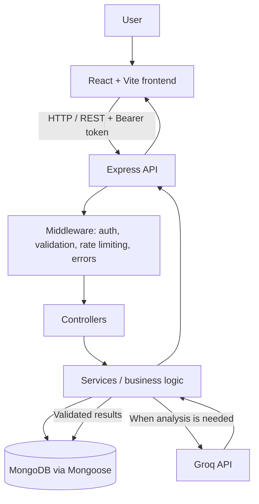

# EcoSearch — AI-Assisted Sustainable Product Search Platform

EcoSearch is a full-stack web application that helps users discover products, explore AI-generated sustainability insights, and compare alternatives by sustainability score and price. It combines a MongoDB-backed product catalog with an LLM-powered analysis feature and a deterministic recommendation engine.

> **Project type:** Portfolio / interview project. Sustainability scores are AI-generated estimates, not scientific measurements or certifications.

## Key Features

- **Product search and catalog:** Search products by relevant text fields, browse product details, and use paginated results.
- **AI sustainability analysis:** Request a score, summary, environmental factors, trade-offs, and possible alternatives through the Groq API.
- **Validated AI responses:** Validate the structure and values returned by the LLM before saving or displaying analysis.
- **Product comparison:** Compare 2–4 products side by side.
- **Deterministic recommendations:** Apply explicit sustainability-score and price rules. AI can explain the result but cannot override the decision.
- **Authentication and authorization:** JWT-based authentication, bcrypt password hashing, and role-based access control.
- **Favorites and search history:** Save products and review previous searches, with user-specific data isolation.
- **Caching and failure handling:** Reuse valid analyses, handle provider errors and timeouts, and keep AI failures separate from the user's authenticated session.
- **Responsive interface:** React UI with loading, empty, and error states for common flows.

## Technology Stack

| Layer | Technologies |
|---|---|
| Frontend | React, Vite, JavaScript, React Context API |
| Backend | Node.js, Express.js, REST APIs |
| Database | MongoDB, Mongoose |
| Authentication | JWT, bcryptjs, role-based middleware |
| AI integration | Groq API through an OpenAI-compatible Chat Completions endpoint |
| Testing | Node.js test runner, frontend tests, Playwright end-to-end coverage |
| Preview layer | Next.js hosting/preview adapter included in the repository |

## Architecture



The backend separates responsibilities across routes, controllers, services, models, and middleware. Controllers handle HTTP request/response concerns; services contain the main business logic; Mongoose models interact with MongoDB. AI calls are made by the backend, not directly from the browser.

## How the AI Analysis Works

1. An authenticated user requests sustainability analysis for a product.
2. The backend checks whether a valid reusable analysis is available.
3. When a new analysis is required, the backend sends selected product fields to the configured Groq model.
4. The expected response contains a score, summary, environmental factors, and alternatives.
5. The backend validates the response before storing it or returning it to the frontend.
6. A valid cached analysis can be reused rather than requesting the LLM again.

The application treats AI output as an estimate. It does not claim that a score is an official environmental certification. Provider errors, timeouts, or invalid output are handled as analysis failures rather than trusted as valid results.

## Recommendation Logic

Product comparison uses application-defined rules rather than delegating the final decision to the LLM:

1. Prefer the product with the highest available sustainability score.
2. When scores are within three points, use price as a value tie-breaker.
3. If the products remain tied, report a tie.
4. If sustainability data is unavailable for every product, return a `no_data` result.
5. Provide reason codes and trade-offs where available.

The optional AI layer can explain the deterministic outcome in plain language, but it does not choose a different winner.

## Security and Reliability

- Passwords are hashed with bcrypt; plaintext passwords are not stored.
- JWT-protected routes authenticate requests, while role middleware protects restricted operations.
- User-specific favorites and history are scoped to the authenticated user.
- The backend validates request data and AI response data.
- AI credentials and the JWT secret belong in the backend environment file only; do not expose them in frontend variables or commit them to GitHub.
- Centralized error handling returns structured errors instead of exposing stack traces to API clients.
- AI requests include timeout/error handling, and valid results are cached to reduce redundant calls.

This is a portfolio project, not a claim of production or enterprise readiness.

## Repository Structure

```text
EcoSearch/
├── backend/
│   ├── src/
│   │   ├── config/          # Environment and database configuration
│   │   ├── controllers/     # HTTP request handlers
│   │   ├── middleware/      # Authentication, validation, rate limiting, errors
│   │   ├── models/          # Mongoose models
│   │   ├── routes/          # Express API routes
│   │   ├── services/        # Product, auth, AI, history, favorites, comparison
│   │   ├── scripts/         # Seed and admin bootstrap scripts
│   │   └── utils/           # Shared helpers
│   └── test/                # Backend tests
├── frontend/
│   ├── src/
│   │   ├── components/      # Reusable UI components
│   │   ├── context/         # Shared authentication/comparison state
│   │   ├── hooks/           # Reusable React hooks
│   │   ├── pages/           # Application pages
│   │   ├── services/        # API client and feature services
│   │   └── utils/           # UI and data helpers
│   └── test/                # Frontend and browser tests
├── scripts/
├── src/                     # Next.js hosting/preview adapter
├── README.md
└── package.json
```

## Getting Started

### Prerequisites

- Node.js 22 LTS
- MongoDB Community Server running locally, or a MongoDB connection string
- A Groq API key for live AI analysis (optional for browsing and comparison)

### 1. Clone the repository

```bash
git clone https://github.com/Shashank07k/EcoSearch.git
cd EcoSearch
```

### 2. Start MongoDB

On Windows, if MongoDB is installed as a service, open PowerShell as Administrator and run:

```powershell
net start MongoDB
```

If you run MongoDB manually, ensure it is listening locally on port `27017`.

### 3. Configure and start the backend

Open a terminal at the repository root:

```powershell
cd backend
npm install
Copy-Item .env.example .env
```

Edit `backend/.env`. Example values for a local setup with Groq:

```env
MONGODB_URI=mongodb://127.0.0.1:27017/ecosearch
PORT=5000
NODE_ENV=development
JWT_SECRET=replace_with_a_long_random_secret
JWT_EXPIRES_IN=1d
AI_API_KEY=YOUR_GROQ_API_KEY
AI_MODEL=openai/gpt-oss-120b
AI_BASE_URL=https://api.groq.com/openai/v1
```

Use your own secret values. Never commit `backend/.env` or paste real credentials into the README. The AI key is optional if you only want to browse and compare products; uncached AI analysis will not work without a valid provider configuration.

Seed the demo catalog and start the API:

```powershell
npm run seed
npm run dev
```

The backend runs on `http://localhost:5000`. Check `http://localhost:5000/api/health` to verify it is available.

### 4. Configure and start the frontend

Open a second terminal at the repository root:

```powershell
cd frontend
npm install
Copy-Item .env.example .env
npm run dev
```

The frontend uses `VITE_API_BASE_URL=/api` and Vite proxies API requests to the backend on port `5000`. Open **http://localhost:5173**.

### 5. Try the application

1. Search the product catalog using terms such as `water`, `bamboo`, or `electronics`.
2. Open a product to view its details.
3. Register or sign in to use sustainability analysis, favorites, and search history.
4. Select 2–4 products and open the comparison page.
5. Review the deterministic recommendation and any available AI explanation.

### Optional: Create an admin user

The admin bootstrap script uses environment variables. Run this from the `backend` directory in PowerShell after configuring the backend:

```powershell
$env:ADMIN_NAME="Your Name"
$env:ADMIN_EMAIL="you@example.com"
$env:ADMIN_PASSWORD="UseA_Strong_Unique_Password"
npm run create-admin
```

Do not use the example password in a real environment.

## API Overview

| Method | Endpoint | Access | Purpose |
|---|---|---|---|
| `GET` | `/api/health` | Public | API/database health status |
| `POST` | `/api/auth/register` | Public | Register a user |
| `POST` | `/api/auth/login` | Public | Log in and receive a JWT |
| `GET` | `/api/auth/me` | Authenticated | Retrieve the current user |
| `GET` | `/api/products` | Public | Browse paginated products |
| `GET` | `/api/products/search?q=` | Public | Search products |
| `GET` | `/api/products/:id` | Public | Get product details |
| `POST` | `/api/products/:id/analyze` | Authenticated | Request sustainability analysis |
| `GET` | `/api/products/compare?ids=id1,id2` | Public | Compare 2–4 products |
| `POST` | `/api/products/recommend` | Public | Calculate a deterministic recommendation with an optional explanation |
| `GET` | `/api/favorites` | Authenticated | List the current user's favorites |
| `POST` | `/api/favorites/:productId` | Authenticated | Add a favorite |
| `DELETE` | `/api/favorites/:productId` | Authenticated | Remove a favorite |
| `GET` | `/api/history` | Authenticated | View the current user's search history |

Administrative product create/update/delete endpoints are restricted to users with the admin role. API responses use JSON with a success or error status structure.

## Environment Variables

### Backend (`backend/.env`)

| Variable | Purpose |
|---|---|
| `MONGODB_URI` | MongoDB connection string |
| `PORT` | API port; defaults to `5000` |
| `NODE_ENV` | Runtime environment |
| `CORS_ORIGIN` | Allowed browser origin(s), if configured |
| `JWT_SECRET` | Secret used to sign JWTs; keep private |
| `JWT_EXPIRES_IN` | JWT lifetime, default `1d` |
| `AI_API_KEY` | Provider key; keep private and server-side |
| `AI_MODEL` | Model identifier supported by the configured provider |
| `AI_BASE_URL` | OpenAI-compatible API base URL |
| `AUTH_RATE_LIMIT_MAX` | Maximum authentication attempts in the configured window |
| `AUTH_RATE_LIMIT_WINDOW_MS` | Authentication rate-limit window in milliseconds |

### Frontend (`frontend/.env`)

| Variable | Example | Purpose |
|---|---|---|
| `VITE_API_BASE_URL` | `/api` | API base path used by the frontend |

Never put secrets in `VITE_*` variables because frontend values are exposed in the browser bundle.

## Testing

Run backend tests:

```powershell
cd backend
npm test
```

Run frontend tests and create a production build:

```powershell
cd frontend
npm test
npm run build
```

Browser tests use Playwright. From the repository root, follow the project's Playwright configuration and test-environment requirements before running:

```powershell
npx playwright test
```

The latest recorded verification completed with **108 backend tests passing** and **52 frontend tests passing**, along with a successful frontend production build and Playwright end-to-end coverage. End-to-end coverage should not be added to the 160 unit/frontend test total unless a separate test count is measured.

## Resume Summary

**EcoSearch — AI-Assisted Sustainable Product Search Platform** | React, Node.js, Express, MongoDB, JWT, Groq API

- Built a full-stack product search platform with JWT authentication, role-based access control, and user-level data isolation across protected routes.
- Integrated Groq LLM API for sustainability analysis with response schema validation, retry/fallback handling, and result caching.
- Implemented deterministic product comparison logic and verified the system with 160 backend and frontend automated tests plus Playwright end-to-end coverage.

## Limitations and Future Improvements

- Sustainability results are estimates and depend on available product data and the selected LLM.
- The demo catalog is seeded data, not a live product-data pipeline.
- The project does not currently include payments, social login, a distributed cache, or a live environmental certification database.
- Possible improvements include verified product/environmental data, richer product sources, and deployment-specific hardening.

## License

No license file is currently included. Add a `LICENSE` file before explicitly permitting reuse or redistribution.
